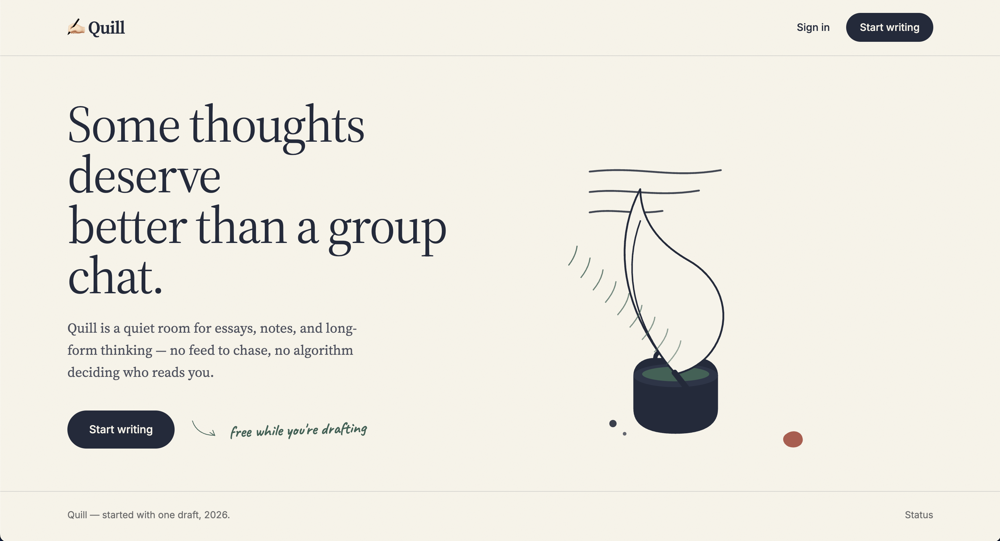

<div align="center">



# ✍🏻 Quill

Quill is a self-hostable writing and reading platform with passwordless sign-in, profiles, feeds, bookmarks, threaded comments, writer clubs, and asynchronous publishing.

</div>

---

## Stack

| Layer | Choice |
|---|---|
| Client | React 19, TypeScript, React Router 7, Tailwind CSS 4, Vite |
| API | Express 5 + TypeScript on Bun |
| Database | PostgreSQL 16 (`pg`) |
| Background jobs | Redis 7 + BullMQ |
| Email | Resend |
| Validation / logging | Zod, Pino |
| Observability | Prometheus, Grafana, Sentry |
| Package manager | Bun workspaces |
| Containers | Docker Compose, Nginx |

## Repository

```text
quill/
├── apps/
│   ├── client/       React SPA                           [README](apps/client/README.md)
│   └── server/       Express API and BullMQ workers      [README](apps/server/README.md)
├── packages/
│   └── shared/       Shared TypeScript DTOs               [README](packages/shared/README.md)
├── services/
│   └── ai/           Standalone FastAPI health service     [README](services/ai/README.md)
├── scripts/          Local helper scripts                 [README](scripts/README.md)
├── docs/             Product, API, and system docs         [index](docs/README.md)
├── docker-compose.yml
└── CHANGE-LOG.md
```

## Current functionality

- Email OTP signup/login with httpOnly access and rotating refresh cookies; logout can revoke the current device or all sessions.
- Onboarding, editable profile and handle, multipart avatar uploads, visitor profiles, follow/follower lists, and follow suggestions.
- Markdown post drafts, editing, immediate or scheduled publishing, paginated For You and Following feeds, and persistent bookmarks.
- Topic-tagged posts and a For You feed shaped by saved genres; untagged legacy posts remain available as fallback.
- Threaded comments with replies, owner edit/delete, and like/heart comment reactions.
- Writer clubs with memberships, invitations and applications, post submission/review, group and direct chat, live club-chat events, image messages, and version-checked shared drafts. Shared drafts are not a simultaneous live editor.
- In-app alerts for follows, followed writers' posts, scheduled publications, comment replies, and club events; opted-in follower emails and a weekly reading digest are delivered by the worker.
- Saved feed-tab, topic, reader text-size/theme, and notification preferences are applied. Product-news email remains unavailable until a newsletter source exists.
- Authenticated reading sessions record active time and maximum scroll depth as signals for future recommendation work; no recommender currently consumes them.
- Self-service account deletion with dependent data removed through database cascades.

Story search runs server-side over published posts using case-insensitive substring matching across title, description, and content. It is not ranked PostgreSQL full-text or semantic search. Topic chips filter currently loaded feed pages; saved genres are also applied by the For You API. The separate Python AI service currently exposes only `/health` and is not connected to the TypeScript API. See the [PRD](docs/PRD.md) and [API reference](docs/API.md) for precise behavior and limitations.

## Future work

Ideas for future product development; these are not currently implemented:

- [ ] Highlighting and annotations
- [ ] Newsletter, email subscribers, and RSS feeds
- [ ] A knowledge graph of articles and blogs
- [ ] Personal reading journal
- [ ] Reading library
- [ ] Read-later list (Queue with estimated reading time)
- [ ] Version history
- [ ] Live Blog Writing Competition (On-the-Spot Topic)
- [ ] Content Moderation
- [ ] Live simultaneous collaborative editing
- [ ] Series / Collection of Blogs (grouping)
- [ ] Upgrade rich text editor (TipTap / ProseMirror)
- [ ] Report and Block users
- [ ] Semantic search over full-text search
- [ ] AI writing assistant
- [ ] AI analytics dashboard and report generation
- [ ] Add skeleton while loading

## Getting started

Prerequisites: Bun 1.3+, Docker Compose (or local PostgreSQL and Redis), and a Resend API key. Server startup validates `DATABASE_URL`, `REDIS_URL`, a JWT secret of at least 32 characters, and `RESEND_API_KEY`.

```bash
git clone https://github.com/AritraC1/quill.git
cd quill
cp .env.example .env
bun install
bun run migrate
```

### Docker Compose

```bash
cp .env.example .env
# Set JWT_SECRET (32+ characters) and RESEND_API_KEY before starting.
docker compose up --build
```

| Service | Host access | Purpose |
|---|---|---|
| `client` | `http://localhost:80` | Nginx SPA and reverse proxy |
| `server` | Internal port 3000 | Express API, Swagger UI and uploaded assets |
| `worker` | Internal only | OTP/follower/digest email, scheduled publishing, notification fan-out |
| `ai-service` | `http://127.0.0.1:8000` | Python FastAPI health endpoint; no model inference or API integration yet |
| `postgres` | `localhost:5432` | Persistent application data |
| `redis` | Internal only | BullMQ queue backend |
| `prometheus` | `http://localhost:9090` | Scrapes API metrics |
| `grafana` | `http://localhost:3001` | Pre-configured metrics dashboard (`admin`/`admin`) |

The Compose file has development-friendly PostgreSQL defaults and publishes PostgreSQL on the host. Set strong credentials and appropriately restrict access before using it beyond a trusted local environment.

## Root commands

```bash
bun run dev:client
bun run dev:server
bun run dev:worker
bun run dev
bun run migrate
bun run build
bun run test
bun run test:server
bun run test:client
```

`bun run dev` starts workspaces with a `dev` script (client and API); it does not start the worker. `./scripts/run.sh` starts PostgreSQL, Redis, Prometheus, and Grafana with Compose, then runs the API, worker, and client locally; it does not run migrations.

**To Run this Project:**
***Option 1:*** In separate terminals, run `bun run dev` for the client and API and `bun run dev:worker` for background jobs. The client is served by Vite (default `http://localhost:5173`) and the API by Express (`http://localhost:3000`). The worker is required for OTP and follower email, weekly digests, scheduled publishing, and notification fan-out. If you use Docker Compose, PostgreSQL applies the migration SQL files when it initializes a new data volume; existing volumes do not automatically rerun those init scripts.

***Option 2:*** In same terminal run via this script - `./scripts/run.sh`. This will start everything.

See the [documentation index](docs/README.md), [API reference](docs/API.md), [architecture](docs/Architecture.md), [system design](docs/System-Design.md), and [change log](CHANGE-LOG.md).

---